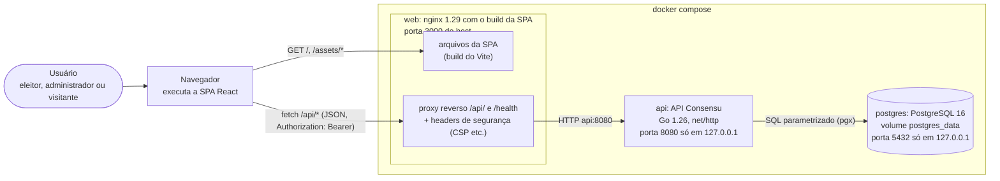
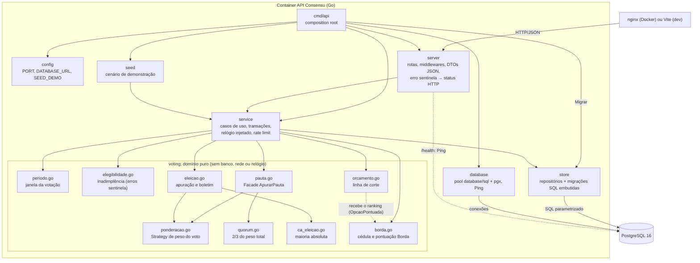
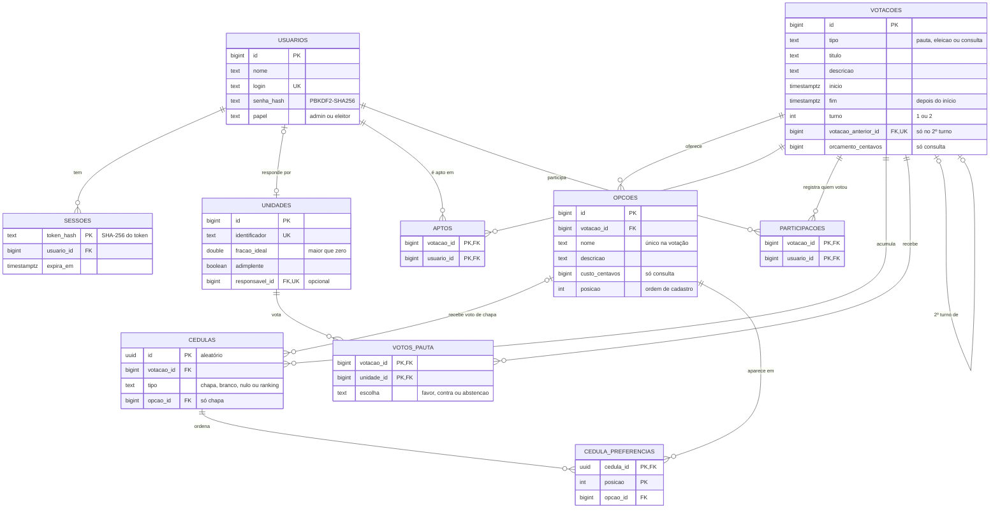
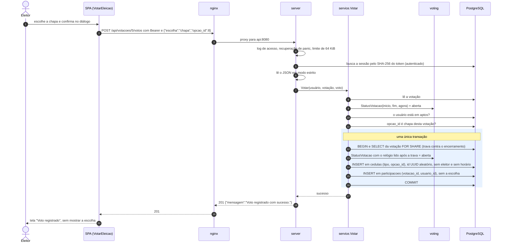

# Arquitetura do Consensu (v1.0.0)

Este documento descreve o sistema como ele está no código: containers, componentes, decisões, modelo de dados e o
que mudou desde a arquitetura apresentada na Atividade 4 (A4). Os diagramas estão em Mermaid (o GitHub os
desenha direto nesta página).

## 1. Containers

O Consensu tem três containers, orquestrados pelo `docker-compose.yml`: a aplicação web (SPA React servida por
nginx), a API (Go) e o banco (PostgreSQL 16). Só a API acessa o banco. O navegador fala apenas com o nginx, que
entrega os arquivos da SPA e encaminha `/api/` e `/health` para a API, de modo que site e API ficam na mesma origem.



| Container | Tecnologia | Responsabilidade | Arquivos |
|---|---|---|---|
| web | React 19 + TypeScript 6 + Vite 8, servido por nginx 1.29 | telas de login, painel, voto, resultado e administração; proxy da API; headers de segurança | `frontend/`, `frontend/Dockerfile`, `frontend/nginx.conf` |
| api | Go 1.26, só biblioteca padrão + pgx | regras de negócio, autenticação, autorização, persistência, apuração | `backend/`, `backend/Dockerfile` |
| postgres | PostgreSQL 16 | dados de usuários, sessões, unidades, votações, participações e cédulas | `backend/internal/store/migrations/` |

Em modo de desenvolvimento, o servidor do Vite (`npm run dev`, porta 5173) faz o papel do nginx: serve a SPA e
encaminha `/api` e `/health` para `http://localhost:8080` (ou `VITE_PROXY_TARGET`).

## 2. Componentes da API



| Componente | Responsabilidade | Principais arquivos |
|---|---|---|
| `cmd/api` | composition root: config → conexão → `store.Migrar` → `service.Novo` → seed (se `SEED_DEMO=true`, usando o service) → `server.NewRouter` → `http.Server` com timeouts e desligamento gracioso (SIGINT/SIGTERM) | `main.go` |
| `config` | lê `PORT` (padrão 8080), `DATABASE_URL` (obrigatória) e `SEED_DEMO` (padrão `false`) | `config.go` |
| `database` | abre o pool `database/sql` com o driver pgx e valida com `Ping` | `database.go` |
| `server` | transporte HTTP: 14 rotas com padrões do Go 1.22 (`"POST /api/votacoes/{id}/votos"`), DTOs, leitura estrita de JSON, middlewares (log de acesso, recuperação de panic, limite de 64 KiB, autenticação, admin) e a tabela que traduz erros do service em status e código | `server.go`, `middleware.go`, `respostas.go`, `dto.go`, `sessao.go`, `votacoes.go`, `unidades.go` |
| `service` | casos de uso: login/logout, listar e detalhar votações, criar, votar, encerrar, abrir 2º turno, apurar, unidades. Valida entradas, controla transações, chama o domínio e recebe o relógio (`func() time.Time`) | `auth.go`, `senha.go`, `limitador.go`, `votacoes.go`, `criar_votacao.go`, `votar.go`, `encerramento.go`, `resultado.go`, `unidades.go` |
| `store` | persistência: um repositório por grupo de tabelas (`Usuarios`, `Sessoes`, `Unidades`, `Votacoes`, `Votos`), `EmTransacao`, `EmLeitura` e o executor de migrações | `store.go`, `migrar.go`, `migrations/0001_esquema_inicial.sql`, um arquivo por repositório |
| `seed` | cria os dados de demonstração chamando os casos de uso do `service` (o mesmo caminho da API) | `seed.go` |
| `voting` | regras dos três contextos como funções puras | ver tabela abaixo |

Arquivos do domínio (`backend/internal/voting`):

| Arquivo | O que faz | Usado por |
|---|---|---|
| `periodo.go` | `StatusVotacao(inicio, fim, agora)`: não iniciada, aberta ou encerrada (janela `inicio ≤ agora < fim`) | service (votar, encerrar, resultado, listagem) |
| `elegibilidade.go` | `ValidarElegibilidade(Condomino) error` com `ErrInadimplente`, `ErrIdentificadorInvalido`, `ErrFracaoIdealInvalida` | service (voto e detalhe da pauta) |
| `ponderacao.go` | Strategy: interface `Ponderacao` com `PesoUnitario` e `PesoPorUnidade`; `ContarVotos` | `pauta.go`, `eleicao.go` |
| `quorum.go` | `AtingiuQuorum`: favoráveis ≥ 2/3 do total; helper `finito` | `pauta.go`, `elegibilidade.go` |
| `pauta.go` | Facade `ApurarPauta`: um voto por unidade, peso total incluindo quem não votou, quórum | service (resultado da pauta) |
| `ca_eleicao.go` | `VerificarMaioriaAbsoluta(lider, outros)` | `eleicao.go` |
| `eleicao.go` | `ApurarEleicao` (chapas, branco, nulo, válidos, vencedora, 2º turno, empate pelo 2º lugar) e `MontarBoletim` (aptos, participantes, abstenções, percentuais) | service (resultado da eleição, abrir 2º turno) |
| `borda.go` | `ValidarCedulaBorda` e `CalcularApuracaoBorda` (pontos, primeiras preferências, empate persistente) | service (voto e resultado da consulta) |
| `orcamento.go` | `AplicarCorteOrcamentario`: custo acumulado, linha de corte única, saldo, empate na linha | service (resultado da consulta) |

### Direção das dependências

```
cmd/api → config, database, store, seed, service, server
server  → service
seed    → service (e constantes de voting)
service → store, voting
store   → database/sql, pgconn (só para reconhecer violação de UNIQUE)
voting  → apenas a biblioteca padrão (errors, fmt, math, slices, sort, strings, time)
```

Só o `cmd/api` importa `server`, e `voting` não importa nenhum pacote interno. O `server` não chama o domínio
diretamente: todo caso de uso passa pelo `service`.

### Componentes do frontend

| Pasta | Conteúdo |
|---|---|
| `src/api` | `client.ts` (único ponto que chama `fetch`, base `/api`, header Bearer, erro tipado `ApiErro`), `types.ts` (contrato da API), `erros.ts` |
| `src/auth` | `AuthContext.tsx`: sessão via `/api/me`, entrar e sair |
| `src/components` | layout com cabeçalho, rotas protegidas, cartão de votação, badges, diálogo de confirmação, alertas, tabela rolável |
| `src/pages` | `Home` (painel), `Login`, `Votar` (`votar/VotarPauta`, `VotarEleicao`, `VotarConsulta`), `Resultado` (`resultado/ResultadoDaPauta`, `BoletimDaEleicao`, `RankingDaConsulta`), `admin/NovaVotacao`, `admin/Unidades`, `NaoEncontrada` |
| `src/utils` | formatação pt-BR (moeda a partir de centavos, percentuais, datas), conversão de reais para centavos, rótulos |

## 3. Estilos arquiteturais

- **Cliente-servidor.** A SPA (cliente) e a API (servidor) são containers independentes que conversam por
  HTTP/JSON. O banco é acessado só pela API.
- **Monólito modular em camadas.** A API é um único executável organizado em pacotes `internal/` com dependências
  num só sentido: transporte (`server`) → aplicação (`service`) → persistência (`store`) e domínio (`voting`). O
  domínio não conhece HTTP, SQL nem relógio.

Não se trata de arquitetura hexagonal completa: o `service` usa os repositórios concretos do `store`, sem
interfaces de porta.

## 4. Decisões

### D1. Regras de domínio em funções puras (mantida da A4)

- **Decisão.** O pacote `voting` só recebe valores e devolve resultados ou erros sentinela. O instante atual é
  parâmetro (`StatusVotacao(inicio, fim, agora)`); quem lê o relógio é o `service`, que o recebe injetado.
- **Justificativa.** As regras têm muitos casos de borda (2/3 exato, maioria com metade dos válidos, janelas
  semiabertas, empates do Borda, linha de corte). Funções puras permitem testá-las de forma determinística e
  exaustiva, com tabelas de casos, classes de equivalência, valores limite e teste de mutação.
- **Trade-offs.** A integração com HTTP, banco e interface exigiu uma camada a mais (o `service`) e conversões de
  tipos (ids do banco viram chaves de texto do domínio). As funções da A4 foram mantidas com as mesmas assinaturas;
  o domínio cresceu com `eleicao.go`, `borda.go` e `orcamento.go`.

### D2. Biblioteca padrão do Go, sem framework web nem ORM (mantida da A4)

- **Decisão.** `net/http` com os padrões de rota do Go 1.22 (`r.PathValue("id")`), `database/sql` com o driver
  pgx, `crypto/pbkdf2`, `crypto/rand`, `crypto/sha256` e `embed`. O `go.mod` tem uma única dependência direta:
  `github.com/jackc/pgx/v5`.
- **Justificativa.** Escopo pequeno, poucas dependências para auditar e atualizar, e código que a equipe consegue
  ler do começo ao fim.
- **Trade-offs.** Roteamento, validação, serialização JSON, middlewares e SQL são escritos à mão. Isso custa
  linhas de código, mas cada regra (limite de corpo, JSON estrito, mapeamento de erro) fica explícita e testada.

### D3. Persistência com Repository e migrações SQL embutidas (nova)

- **Decisão.** O pacote `store` tem um repositório por grupo de tabelas, todos reunidos em `store.Repositorios`.
  `store.EmTransacao` executa uma função com os repositórios ligados a uma transação; `store.EmLeitura` faz o mesmo
  numa transação `REPEATABLE READ` somente leitura. O esquema fica em `migrations/*.sql`, embutido no binário com
  `embed`, e um executor próprio (`migrar.go`) aplica cada arquivo uma vez, em ordem, cada um na sua transação,
  registrando em `schema_migrations` e protegido por `pg_advisory_lock` contra duas instâncias migrando juntas. A
  API migra o banco ao iniciar.
- **Justificativa.** Na A4 o Repository foi descartado por não haver esquema nem consumidor. Agora há os dois: os
  casos de uso precisam de leituras e escritas atômicas (cédula + participação; votação + opções + aptos), e
  isolar o SQL num pacote permite testá-lo contra um Postgres real. Embutir as migrações elimina um passo manual
  para quem executa o projeto.
- **Trade-offs.** SQL manual (coerente com D2) e um executor de migrações mínimo, só para frente (sem
  `down`). Os repositórios são tipos concretos: o `service` é testado contra o Postgres, não contra dublês.

### D4. Autenticação por token de sessão opaco, senha com PBKDF2 e papéis admin/eleitor (nova)

- **Decisão.** O login devolve um token aleatório de 32 bytes (base64url). O banco guarda só o SHA-256 do token,
  com validade de 12 horas; o logout apaga a sessão. Senhas usam PBKDF2-SHA256 da biblioteca padrão, com 210.000
  iterações, sal aleatório de 16 bytes e comparação em tempo constante; login inexistente gasta o mesmo custo de
  hash. Há dois papéis: `admin` (síndico, comissão eleitoral, organizador) e `eleitor`. O `server` aplica
  `autenticado` e `somenteAdmin` por rota; o `service` aplica as regras de quem pode votar (aptos, responsável pela
  unidade, adimplência).
- **Justificativa.** Sessão no servidor permite revogar no logout sem lista de bloqueio, o que um JWT não daria
  sem estado extra. `crypto/pbkdf2` está na biblioteca padrão desde o Go 1.24, então não é preciso
  `golang.org/x/crypto` (bcrypt ou argon2), o que manteria D2.
- **Trade-offs.** Cada requisição autenticada faz uma consulta à tabela `sessoes`. O frontend guarda o token no
  `localStorage`, legível por qualquer script da página; isso é mitigado pela CSP restritiva, pela ausência de
  scripts de terceiros e de `dangerouslySetInnerHTML`. O limite de tentativas de login fica em memória (ver
  [README, Segurança](../README.md#segurança)). O papel "Auditor" da A1 saiu do escopo porque o boletim é público.

### D5. Sigilo do voto pela separação entre participação e cédula (nova, muda a A1)

- **Decisão.** "Quem votou" (`participacoes`: votação + usuário, sem escolha e sem horário) e "o que foi votado"
  (`cedulas` e `cedula_preferencias`: sem eleitor, sem horário, id UUID aleatório) ficam em tabelas separadas,
  gravadas na mesma transação. A resposta do voto nunca repete a escolha, o boletim só tem totais e o log de acesso
  só registra método, caminho, status e duração. A A1 prometia "votos de forma criptografada e desvinculada"; a
  v1.0.0 entrega a desvinculação, sem criptografia.
- **Justificativa.** Criptografar a cédula com uma chave guardada pelo próprio servidor não impede quem opera o
  servidor de decifrá-la, e a apuração precisa ler as escolhas. Sem o vínculo eleitor-cédula, não há o que
  decifrar: a aplicação, a API, os boletins e os logs não conseguem associar um eleitor ao seu voto. A regra é
  verificável por teste (`TestColunasDasTabelasDeVotoSecreto` confere as colunas das tabelas).
- **Trade-offs e limite.** Quem tem acesso direto ao banco é confiável. Como participação e cédula são gravadas na
  mesma transação, as duas linhas têm o mesmo valor na coluna de sistema `xmin` e ficam próximas no WAL; um
  operador do banco consegue reassociá-las. Separar em duas transações quebraria a atomicidade (voto sem
  participação ou o contrário), e embaralhar as cédulas no encerramento não cobriria o fim natural do prazo nem o
  WAL. Por isso o banco deve ficar privado: o compose publica a porta 5432 só em `127.0.0.1`, para
  desenvolvimento. O voto da pauta de condomínio é nominal por unidade, como numa assembleia, e não é secreto.

### D6. Mesma origem via proxy, em vez de CORS, e Docker Compose para reprodutibilidade (nova)

- **Decisão.** O frontend chama a API por caminho relativo (`/api/...`). Em desenvolvimento, o proxy do Vite
  encaminha para a API; no Docker, o nginx do container `web` faz o mesmo. A API não tem CORS. O
  `docker-compose.yml` sobe Postgres, API e web com healthchecks em cadeia (web espera a API saudável, que espera o
  Postgres saudável), e `docker compose up --build` deixa o sistema pronto com os dados de demonstração. As
  credenciais do Postgres vêm do `.env` da raiz (copiado de `.env.example`), não do compose.
- **Justificativa.** Sem CORS não há política de origens a configurar nem a errar, e o token nunca precisa ser
  aceito de outra origem. O compose dá a qualquer pessoa o mesmo ambiente com dois comandos (`cp .env.example .env` e `docker compose up --build`), e o CI usa o mesmo
  arquivo para os testes de ponta a ponta.
- **Trade-offs.** Toda implantação precisa de um proxy na frente da API e da SPA: o binário publicado na release
  não serve o frontend. A A1 previa deploy em produção; a v1.0.0 é executada localmente (Docker Compose) e
  publicada como GitHub Release com o binário da API e o build da SPA ([release.md](release.md)). O demo usa HTTP
  sem TLS.

### Concorrência e consistência

| Situação | Como o código trata | Teste |
|---|---|---|
| Duas instâncias migrando ao mesmo tempo | `pg_advisory_lock` em `store.Migrar` | `TestMigrarEIdempotenteEConcorrente` (6 migrações simultâneas num schema vazio) |
| Voto duplicado, inclusive em pedidos simultâneos | chaves primárias de `participacoes` e `votos_pauta` (o banco recusa o segundo); a cédula é gravada antes da participação, então a violação desfaz a cédula | `TestVotarPauta`, `TestVotarEleicao`, `TestVotarConsulta` (segundo voto não deixa cédula nem preferências extras) |
| Voto chegando durante o encerramento | o voto começa a transação com `SELECT ... FOR SHARE` da votação e só então lê o relógio; `Encerrar` faz `UPDATE ... WHERE inicio < agora AND fim > agora`, que espera os votos em andamento. Voto que esperou o encerramento lê o fim novo e recebe `409` | `TestTravaDoVotoContraEncerramento`, `TestVotosConcorrentesComEncerramento` |
| Resultado lido enquanto votos confirmam | `Resultado` lê tudo numa transação `REPEATABLE READ` somente leitura | `TestEmLeituraVeUmRetratoFixoESoLe`, `TestResultadoConsistenteComVotosNoFimDoPrazo` |
| 2º turno aberto duas vezes | o `service` recusa quando já existe 2º turno, e `votacao_anterior_id UNIQUE` cobre dois pedidos simultâneos | `TestAbrirSegundoTurno` ("não abre um segundo 2º turno") |

Limite conhecido: no fim natural do prazo (sem `Encerrar`), um voto que passou pela checagem alguns milissegundos
antes do `fim` ainda pode confirmar logo depois dele; um resultado consultado nesse intervalo pode ganhar esse voto
ao recarregar. O encerramento manual não tem esse intervalo.

## 5. Modelo de dados

Esquema da migração [`0001_esquema_inicial.sql`](../backend/internal/store/migrations/0001_esquema_inicial.sql).
Não existe relação entre `CEDULAS` (ou `CEDULA_PREFERENCIAS`) e `USUARIOS`: é essa ausência que garante o sigilo
(D5).



| Tabela | Uso por tipo de votação |
|---|---|
| `votos_pauta` | pauta: voto nominal da unidade; o peso é a fração ideal, aplicada na apuração. Aptos = todas as unidades com responsável |
| `aptos`, `participacoes`, `cedulas` | eleição e consulta. Na eleição, `opcoes` são as chapas e branco/nulo são tipos de cédula. Na consulta, `opcoes` são os projetos (com custo) e a cédula `ranking` tem uma linha em `cedula_preferencias` por posição |
| `schema_migrations` | criada pelo executor de migrações (`versao`, `aplicada_em`) |

Pesos (fração ideal) são `double precision` / `float64`; dinheiro é `bigint` em centavos / `int64`.

## 6. Fluxo de uma requisição: voto secreto na eleição



Se o eleitor já votou, o `INSERT` em `participacoes` viola a chave primária, a transação inteira é desfeita
(inclusive a cédula) e a API responde `409 voto_duplicado`. Na consulta o fluxo é o mesmo, com a cédula `ranking`
e uma linha de `cedula_preferencias` por posição, depois de `voting.ValidarCedulaBorda`. Na pauta, o `service`
busca a unidade do usuário, aplica `voting.ValidarElegibilidade` (inadimplente → `403 inadimplente`) e grava em
`votos_pauta`.

## 7. Padrões de projeto e refatoração da A4 no sistema atual

- **Strategy (`ponderacao.go`).** `ContarVotos(opcoes, votos, p Ponderacao)` delega o peso de cada voto à
  estratégia. Na A4 havia só o contexto; agora as duas estratégias têm consumidores reais: `ApurarPauta` usa
  `PesoPorUnidade` (fração ideal da unidade, história #17) e `ApurarEleicao` usa `PesoUnitario` (um eleitor, um
  voto, história #20). Como `PesoUnitario` ignora o identificador, a eleição é apurada a partir de cédulas
  anônimas, sem id de eleitor. `ContarVotos` recusa estratégia nula com `ErrPonderacaoAusente`.
- **Facade (`pauta.go`).** `ApurarPauta` esconde a ordem de ponderação, contagem e quórum. O caso de uso
  `resultadoPauta` (`service/resultado.go`) faz uma única chamada, passando as unidades com responsável e os votos,
  e usa o retorno para montar o relatório da pauta (#19).
- **Refatoração de `ValidarElegibilidade` (smell Primitive Obsession).** A função passou de `(bool, string)` para
  `error` com erros sentinela. Isso permite a cadeia que leva o bloqueio até a resposta HTTP sem comparar textos:
  `voting.ErrInadimplente` → `service.ErrInadimplente` (`service/votar.go`) → tabela `errosDoServico`
  (`server/respostas.go`) → `403 {"codigo":"inadimplente"}`, inclusive para voto enviado direto à API (#18).
- **Duplicated Code (smell 3.2 da A4).** A checagem "não é NaN nem infinito", repetida em `quorum.go` e
  `elegibilidade.go`, virou o helper `finito`, mantendo as mesmas comparações cobertas pelos testes da A5.
- **Repository (`store`).** Ver D3: agora há esquema e consumidores.
- **Middlewares.** `server/middleware.go` envolve o `http.Handler` em camadas (`registrarAcesso`,
  `recuperarPanico`, `limitarCorpo`, `autenticado`, `somenteAdmin`), no estilo Decorator. Na A4 isso foi descartado
  porque havia um único endpoint; com 14 rotas, evita repetir autenticação e tratamento de erro em cada handler.

## 8. O que mudou em relação à A4

| Elemento | Na A4 | Na v1.0.0 | Motivo |
|---|---|---|---|
| Aplicação web | "hoje apenas a página inicial" | SPA com login, painel, voto (3 tipos), resultado (3 tipos), nova votação, unidades e página 404 | entregar as histórias de ponta a ponta |
| Web → API | relação planejada ("consumirá") | `frontend/src/api/client.ts` chama `/api` na mesma origem (D6) | idem |
| API → domínio | relação planejada (`server` "usará" `voting`) | o `server` chama o `service`, que chama `voting` | casos de uso precisam de transação, persistência e autorização, que não cabem no handler HTTP nem no domínio puro |
| `server` | só `GET /health` | 14 rotas, DTOs, middlewares, mapeamento de erros. `/health` manteve o comportamento (405 para outros métodos) | idem |
| `config` | `PORT`, `DATABASE_URL` | + `SEED_DEMO` | dados de demonstração reproduzíveis |
| Persistência | "schema de domínio ainda não criado"; Repository descartado | migração `0001` com 10 tabelas e o pacote `store` (D3) | agora há esquema e consumidores |
| Novos pacotes | — | `service`, `store`, `seed` | camadas de aplicação, persistência e demonstração |
| Domínio | 6 componentes (janela, elegibilidade, maioria, ponderação, quórum, apuração de pauta) | + `eleicao.go`, `borda.go`, `orcamento.go` | histórias #20 a #25 |
| Borda | em PR separado, com uma cópia em `internal/domain/borda` | `borda.go` dentro de `voting`, com desempate por primeiras preferências e empate persistente sinalizado | um único pacote de domínio, coerente com o diagrama |
| Strategy, Facade e refatoração | descritos no relatório, em PRs ainda não integrados | fazem parte do pacote `voting` e são usados pelo `service` (seção 7) | coerência entre relatório e código |
| Sigilo (A1) | votos "criptografados e desvinculados" | desvinculação sem criptografia (D5) | a criptografia com chave no próprio servidor não protege contra o operador |
| Papéis (A1) | Administrador, Eleitor, Auditor | `admin` e `eleitor` | boletim público dispensa o auditor |
| Implantação (A1) | deploy em produção | Docker Compose local + GitHub Release com binário e build da SPA (D6) | escopo acadêmico; sem hospedagem |
| Usuário → web | rotulado "HTTPS" | HTTP local (demo) | TLS fica para uma implantação real |

Permanece da A4 a limitação dos pesos em `float64`: com frações não inteiras, um valor que deveria ser exatamente
2/3 pode ficar logo abaixo (por exemplo 0,6 de 0,9). O seed usa áreas inteiras em m², cujas somas são exatas.
